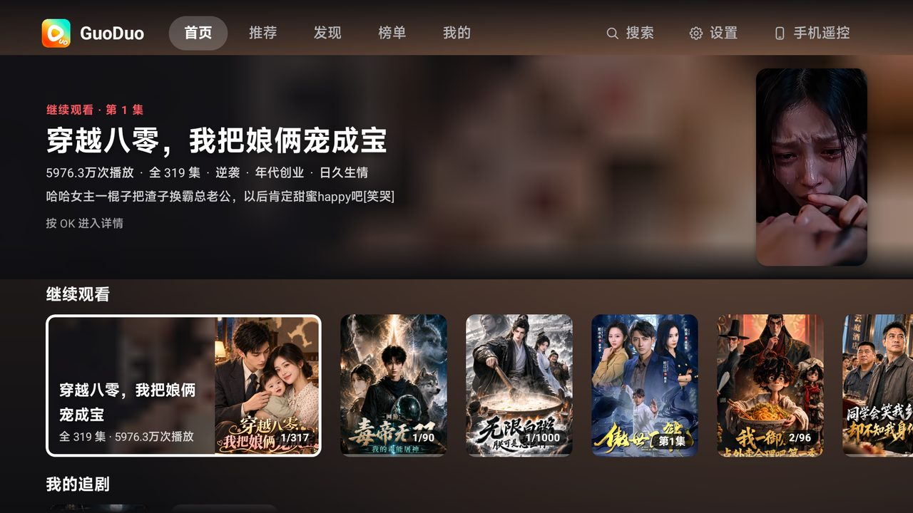
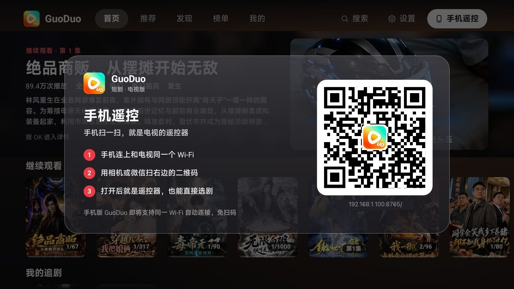
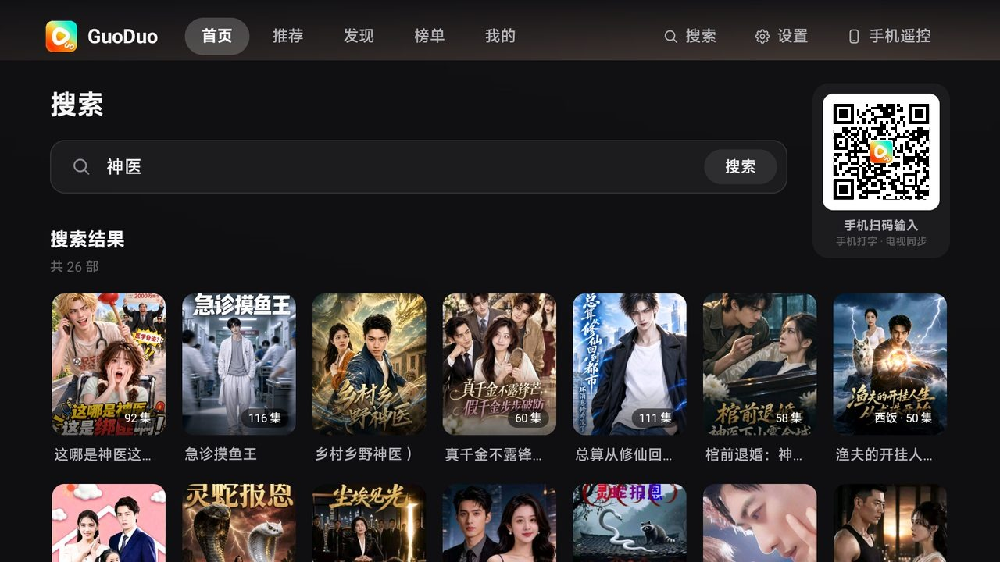
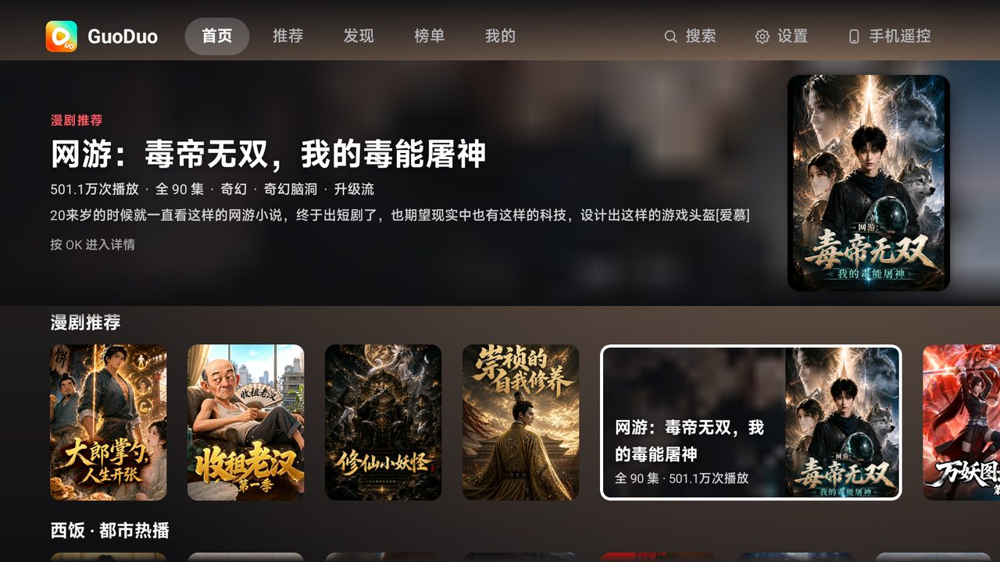
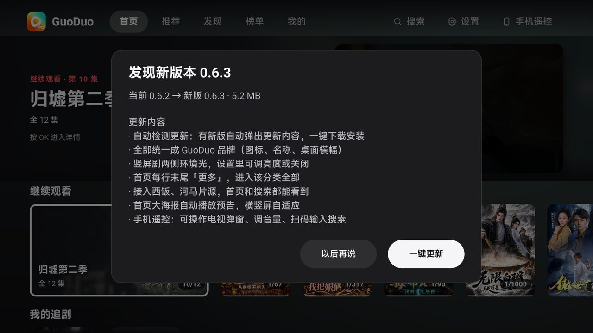

<p align="center">
  
</p>

<h1 align="center">GuoDuo TV</h1>

<p align="center">GuoDuo 的安卓电视 / 投影仪版：用遥控器在大屏上刷短剧，用手机扫码当遥控器和输入法。开源免费，非官方。</p>

手机上有 [GuoDuo](https://github.com/81199000/GuoDuo)，客厅电视上也想接着看，所以做了 GuoDuo TV。原生安卓实现（纯 Java + Media3 硬件解码），一个安装包通用 32 / 64 位 ARM 与 x86；界面照 GuoDuo 手机版的奈飞式首页重做，遥控器按键全部重新设计过。和手机版配合：手机能一键把它装到电视上，扫码就是遥控器，两边还能互相接着看。

> ⭐ **点个 Star，再关注 [@81199000](https://github.com/81199000)，避免走失。** 官网 **[oneduo.app](https://oneduo.app)** 是长期固定入口，以后仓库再搬家也能从官网找到。

## 同系列项目

- **[DouDuo](https://github.com/81199000/DouDuo)**：第三方抖音客户端，原生 SwiftUI，适配折叠屏内屏 / iPad，推荐、评论、私信、直播都能用。
- **[GuoDuo](https://github.com/81199000/GuoDuo)**：红果短剧第三方客户端，原生播放，适配折叠屏 / iPad，和 GuoDuo TV 联动。
- **[GuoDuo TV](https://github.com/81199000/GuoDuo-TV)**（本项目）：GuoDuo 的安卓电视 / 投影仪版：遥控器刷剧，手机扫码当遥控器，和手机版互相接着看。
- **[一键签 OneDuo](https://github.com/81199000/OneDuo)**：Windows / Mac 装机工具，用自己的 Apple ID 免费把上面这些 App 签名装到手机，到期自动续签、有新版自动更新。
- 官网 **[oneduo.app](https://oneduo.app)**：所有项目的统一下载入口。



## 功能

**首页**
- 顶部一行导航：首页 / 推荐 / 发现 / 榜单 / 我的，右边是搜索、设置、手机遥控。
- 大海报：同一张封面模糊铺底，左边剧名、热度、集数、题材、简介，右边完整竖海报（不裁切）。
- 焦点停在一部剧上 1.2 秒，海报位置就**静音播放这部剧的第 1 集**；横屏剧、竖屏剧自动换画框比例。
- 下面一行行横着选：继续观看（带进度）、我的追剧、今日热播 Top 10、为你推荐、新剧上线、口碑必看、漫剧、真人剧、AI 剧、西饭、河马……每行拉到最后是「更多」，进去看这个分类全部。

**播放**
- 左右快退快进（只出进度条），上下切上一集 / 下一集（「推荐」里是换剧）。
- OK 暂停 / 继续；**按住 OK 2 秒 = 2 倍速**，再按住一次取消。
- 菜单键呼出右侧玻璃菜单：选集、倍速、弹幕、收藏、返回，5 秒不动自动收起。返回键先收菜单，再按回首页。
- 竖屏剧两侧**环境光**：黑边处铺一层画面颜色的柔光（关 / 亮 / 中 / 暗）。
- 弹幕来自剧集真实评论，开关、速度、字号、透明度可调。H.265 硬件解码，最高 1080P。

**手机遥控**（不用装 App，扫码即用）
- 遥控器面板：方向键（按住连发）、OK（按住 2 秒倍速）、返回、首页、菜单、播放 / 暂停。
- **音量**：静音 / 减 / 加，直接调电视音量。
- 电视上弹出来的框（退出确认、选集、设置选项）手机也能操作。
- 在手机上选剧、看详情、点播放直接在电视上播；手机设置页能改电视的设置。
- 搜索页右上角扫码：**手机上打字，电视搜索框同步显示**，手机点搜索电视就出结果。

**其它**
- 片源：红果为主，另外融合**西饭**、**河马**的免费剧集（首页单独成行、搜索结果自动合并，卡片角上标片源）。
- **自动检测更新**：有新版弹出更新内容，一键下载安装。
- 收藏、观看进度和手机红果 App 同步。
- 久看提醒、整点报时、强制休息时段；深色 / 浅色主题。

<table>
  <tr>
    <td width="50%"></td>
    <td width="50%"></td>
  </tr>
  <tr>
    <td align="center"><sub>播放中按「菜单」：右侧玻璃菜单</sub></td>
    <td align="center"><sub>竖屏剧两侧环境光</sub></td>
  </tr>
  <tr>
    <td></td>
    <td></td>
  </tr>
  <tr>
    <td align="center"><sub>手机扫码遥控</sub></td>
    <td align="center"><sub>搜索：右上角扫码用手机打字</sub></td>
  </tr>
  <tr>
    <td></td>
    <td></td>
  </tr>
  <tr>
    <td align="center"><sub>西饭 / 河马片源，卡片角标区分</sub></td>
    <td align="center"><sub>自动检测更新</sub></td>
  </tr>
</table>

<sub>实机截图（小米电视 1920×1080）。</sub>

## 下载安装

支持 **Android 6.0 及以上**的智能电视、电视盒子、投影仪，需要设备支持 H.265（HEVC）硬件解码。三种装法，任选一种：

| | 方式一：手机 GuoDuo 推送（推荐） | 方式二：U 盘 | 方式三：电脑 ADB |
| --- | --- | --- | --- |
| 要电脑吗 | 不要 | 不要 | 要 |
| 怎么装 | 手机自动找到电视推过去 | 电视文件管理里点安装包 | 命令行安装 |
| 适合 | 家里有 iPhone 装了 GuoDuo | 电视有 USB 口 | 开发 / 调试 |

### 方式一：手机 GuoDuo 推送

1. iPhone 上打开 [GuoDuo](https://github.com/81199000/GuoDuo) →「我的 → 设置 → 安装到电视」。
2. 按提示在电视上打开「ADB 调试」（一般在「设置 → 关于 / 安全」里），手机和电视连同一个 Wi‑Fi。
3. 手机会自动找到电视，把 GuoDuo TV 推过去装好并打开。

### 方式二：U 盘

1. 到 [oneduo.app](https://oneduo.app) 下载 `guoduo-tv-<版本>.apk`，拷进 U 盘。
2. U 盘插电视，用电视自带的「文件管理 / 媒体中心」打开安装包。
3. 电视提示「安装未知应用 / 未经安全审核」时，选「允许 / 继续安装」。

### 方式三：电脑 ADB

```sh
adb connect <电视IP>:5555
adb install -r guoduo-tv.apk
```

### 第一次打开：登录

用手机红果短剧 App（或手机 GuoDuo 的「扫一扫」）扫电视屏幕上的二维码登录，也可以用手机号验证码登录。登录后收藏、观看进度和手机同步。

> 更新不用重装：每次打开 GuoDuo TV 会自动检查，有新版弹出更新内容，点「一键更新」即可，观看记录和收藏保留。**第一次更新**时电视会跳到「安装未知应用」，把 GuoDuo 的开关打开、按返回就会继续装，只需一次。

## 使用教程

### 遥控器怎么按

| 场景 | 按键 | 作用 |
| --- | --- | --- |
| 首页 | 上 / 下 | 一行一行走；第一行再按上 → 顶部导航 |
| 首页 | 左 / 右 | 在一行里选剧；拉到最后是「更多」 |
| 首页 | OK | 打开详情 |
| 首页 | 菜单 | 焦点跳到顶部导航 |
| 首页 | 返回 | 在剧集行里 → 回顶部；已在顶部 → 弹「退出 GuoDuo？」 |
| 播放中 | 左 / 右 | 快退 / 快进 |
| 播放中 | 上 / 下 | 上一集 / 下一集 |
| 播放中 | OK | 暂停 / 继续；按住 2 秒 2 倍速 |
| 播放中 | 菜单 | 右侧菜单（选集 / 倍速 / 弹幕 / 收藏 / 返回） |
| 播放中 | 返回 | 先收菜单，再按回首页 |

### 手机遥控

1. 手机和电视连**同一个 Wi‑Fi**。
2. 电视上点顶部「手机遥控」，或「设置 → 遥控 → 连接手机」，屏幕出现二维码。
3. 手机相机 / 微信扫码，浏览器打开 GuoDuo 遥控页，点「同意并继续」。底部「遥控」页就是遥控器。

> 装了手机版 GuoDuo 的话，用 App 里的「连接遥控器」更方便：局域网自动发现电视，绑定一次以后不用再扫码，还能「投到电视」「接到手机继续看」。

公共网络下建议在电视「设置 → 遥控」设一个遥控密码，或者关掉手机遥控。

### 设置里有什么

| 分组 | 项目 |
| --- | --- |
| 播放 | 默认画质（1080P ~ 360P）、环境光（关 / 亮 / 中 / 暗）、首页预告、自动连播、保持倍速 |
| 弹幕 | 显示、速度、字号、透明度 |
| 提醒 / 休息 | 久看提醒、整点报时、强制休息、休息时段（时段内不能用 App 和手机遥控） |
| 遥控 | 手机遥控开关、遥控密码、连接手机 |
| 外观 | 主题（深色 / 浅色 / 跟随时间） |
| 关于 | 检查更新、关于软件 |

手机遥控页「我的 → 设置」里也能改这些（遥控密码只能在电视上改）。

## 常见问题

- **扫码后手机打不开遥控页**：手机和电视要连同一个 Wi‑Fi（访客网络、AP 隔离会挡住）；电视「设置 → 遥控」里手机遥控要开着。
- **首页预告不播 / 播一下就没了**：多数电视只有一路硬件解码，GuoDuo TV 离开「推荐」时会把解码器让给预告；你的电视还是冲突的话，在设置里关掉「首页预告」。
- **更新时跳到「安装未知应用」**：第一次更新要允许 GuoDuo 安装应用，打开开关后按返回自动继续，只需一次。
- **更新装完没自动打开**：Android 14 起系统不让应用在后台自己启动，在系统「安装成功」页点「打开」。
- **西饭 / 河马的剧集数比原站少**：只列可以免费看的集，要付费解锁的不放出来。
- **某部剧放不了**：部分集数只有 ByteVC2 编码，电视解不了；或者在红果需要解锁。
- **小米电视 ADB 老是自己关**：小米系统重启后会关 ADB，要用的时候在「设置 → 安全 / 关于 → ADB 调试」重新打开。

## 构建

需要 JDK 17 / 21、Android SDK（build-tools **35.0.0** + platforms **android-35**）和 Python 3。不用 Gradle / Android Studio，`build_local.py` 直接调用 aapt2 / javac / d8 / apksigner 出包，一次一两分钟。

```sh
git clone https://github.com/81199000/GuoDuo-TV.git && cd GuoDuo-TV
brew install openjdk@21 && brew install --cask android-commandlinetools
sdkmanager "build-tools;35.0.0" "platforms;android-35"

export JAVA_HOME=/opt/homebrew/opt/openjdk@21
export ANDROID_SDK_ROOT=/opt/homebrew/share/android-commandlinetools
# 调试包用 Android 自带的 debug 签名
export LVGUO_KEYSTORE=~/.android/debug.keystore LVGUO_STORE_PASSWORD=android LVGUO_KEY_PASSWORD=android
export LVGUO_APPLICATION_ID=me.rrmm.guoduo.tv LVGUO_APP_LABEL=GuoDuo LVGUO_OUTPUT_NAMES=guoduo-tv.apk
LVGUO_VERSION_NAME=0.6.6 LVGUO_VERSION_CODE=95 python3 build_local.py   # → out/guoduo-tv.apk
```

这些变量也可以写进 `build.local.json`（已在 `.gitignore`），键名见 `build_local.py` 里的 `setting()`。

> 调试包和正式包签名不同，不能互相覆盖安装；已装正式包的电视要先卸载（会清掉登录）。正式签名 keystore 和口令**绝不入库**。

调试常用：

```sh
adb install -r out/guoduo-tv.apk
adb shell monkey -p me.rrmm.guoduo.tv -c android.intent.category.LEANBACK_LAUNCHER 1
adb logcat -s TVPlayback HeroPreview TVCompanion   # 播放 / 首页预告 / 手机遥控
```

## 目录结构

- `build_local.py`：不用 Gradle 的出包脚本
- `res/raw/companion.html`：手机遥控网页（电视内置，扫码打开）
- `src/ink/pengfei/lvguo/ui/`：电视界面——`RootActivity`（顶部导航、页面切换、返回键）、`page/HomePage`（首页各行、更多）、`page/SearchPage`（三源搜索、扫码输入）、`widget/HeroBanner`（大海报 + 预告）、`widget/AmbientLight`（环境光）、`widget/GlassMenu`（右侧玻璃菜单）、`TrackedDialog`（所有弹窗的基类，手机遥控能操作）
- `src/ink/pengfei/lvguo/PlaybackHostActivity.java`：播放器（推荐页内嵌和全屏共用）
- `src/ink/pengfei/lvguo/net/`：红果接口（`Repo` 详情 / 播放、`Browse` 榜单 / 分区），`OtherSources` 是西饭 / 河马
- `src/ink/pengfei/lvguo/media/`：Media3 播放、清晰度选择、解码策略
- `src/ink/pengfei/lvguo/remote/`：局域网服务（默认端口 8765，mDNS `_guoduo._tcp`）、扫码页、手机读写电视设置；接口说明见 [docs/phone-remote-api.md](docs/phone-remote-api.md)
- `src/ink/pengfei/lvguo/update/`：自动检测更新、下载（断点续传 + SHA‑256 校验）、安装
- `src/ink/pengfei/lvguo/care/`：久看提醒、整点报时、休息时段
- `tv-playback-module/`：播放签名模块（Kotlin）
- `web/`：桌面网页版（Go），沿用上游，没有重做

## 发版

正式版（用于自动更新的签名包、上传安装包和更新清单）由维护者在本机完成，发版脚本不在开源仓库里。想自己装，按上面「构建」出调试包即可；新版本见 [oneduo.app](https://oneduo.app)。

## 免责声明

> 本声明说明项目意图与边界，**不构成法律意见，也不能免除法律责任**。

GuoDuo TV 是非官方客户端，与红果短剧 / 字节跳动、西饭、河马及任何内容方**没有任何隶属、合作或授权关系**，不存储、不提供任何视频内容，片源均来自各平台接口。接口未公开，随时可能失效；不支持 ByteVC2 编码的集数。仅供个人学习研究使用，请勿用于商业用途或传播，所有商标归各自权利人所有。登录凭证只保存在你自己的电视上，可以随时退出清除。

## 致谢、上游与许可

GuoDuo TV 基于以下上游项目修改，感谢原作者：

- **基础工程**：[Amor5207/lvguo-tv](https://github.com/Amor5207/lvguo-tv)（绿果 TV，GPL-3.0）。电视端播放、账号、手机遥控服务、网页版沿用它的实现，界面、交互和品牌已重做。
- **签名与登录参考**：[aston314/hongguo-tv](https://github.com/aston314/hongguo-tv)（请求签名与手机号登录）、[N3urda/hongguoTV](https://github.com/N3urda/hongguoTV)（播放 V5 签名）。
- **西饭 / 河马片源**：照姊妹项目 [GuoDuo](https://github.com/81199000/GuoDuo) 的 `core/upstream/xifan.js`、`hema.js` 移植。

其余第三方组件、依赖及开源许可证见 [THIRD_PARTY_NOTICES.md](THIRD_PARTY_NOTICES.md) 与 [third_party/](third_party/)。

本项目以 [GPL-3.0](LICENSE) 协议开源：你可以自由使用、修改和再分发，但衍生作品同样必须以 GPL-3.0 开源。

